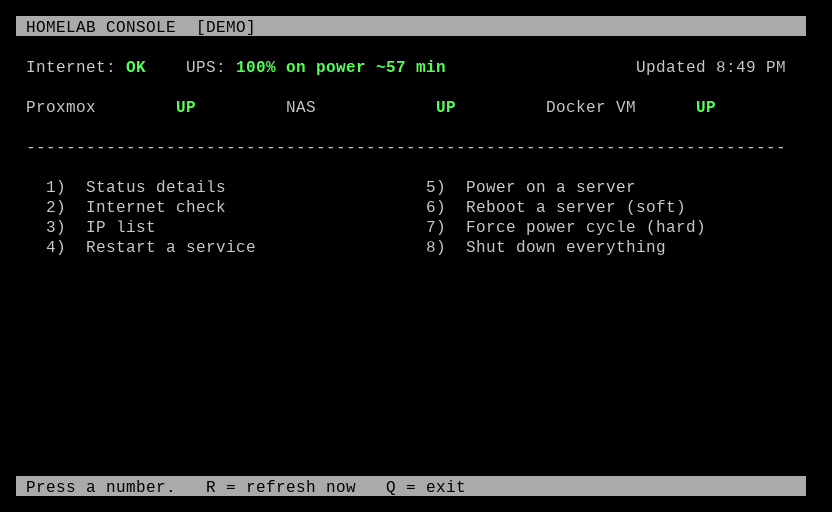
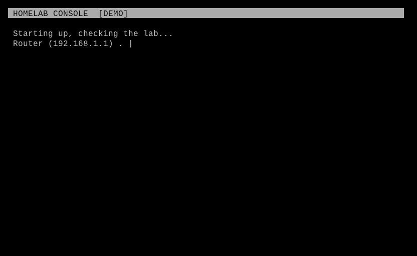
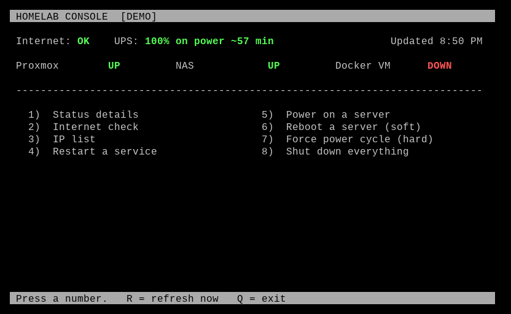
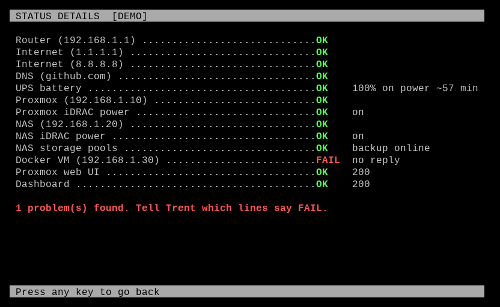
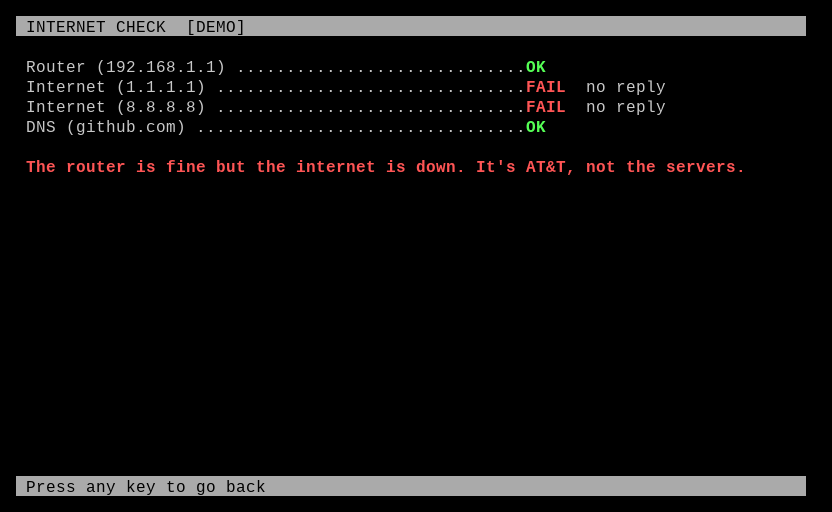
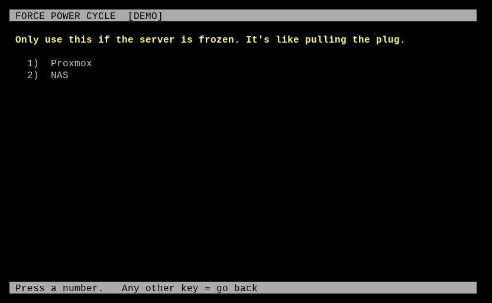
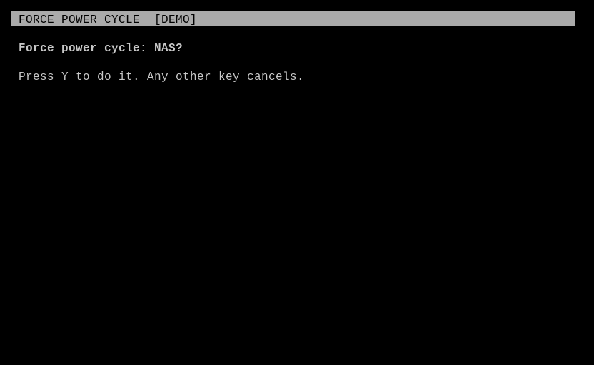
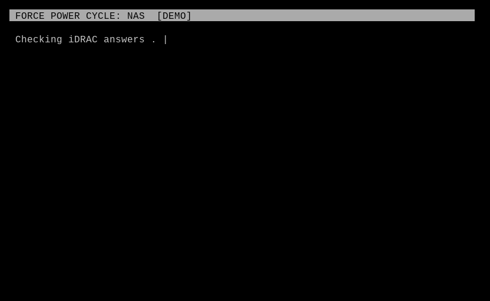

# homelab-console

A number-key menu for my homelab, meant to run full screen on a small
computer hooked up to an old CRT. It's a fail-safe: if I'm away and can't
reach anything, someone at home can read the screen to me over the phone
and press a key to reboot a server.



Starting up, it checks everything one line at a time, like a server's boot
screen:



When something is wrong, it says so in plain words:







Anything that changes something asks first, then shows each step live and
ends with `DONE. Tell Trent: OK` or `FAILED. Tell Trent: code 7-3` (menu
number, then the step that failed):







## Design

- Works when the rest of the lab doesn't. It talks to machines by LAN IP,
  not through Tailscale, DNS or the reverse proxy.
- Real power control goes through IPMI (Dell iDRAC), so a frozen server
  can still be power cycled. Soft reboots go over SSH, or the TrueNAS API
  for the NAS.
- Reads UPS status straight from NUT (no login needed for reads).
- Anything that changes something asks for Y first. "Shut down
  everything" asks twice and goes in order (VMs first, the NAS last).
- Screen goes black after 5 minutes idle so the CRT doesn't burn in.
  Any key wakes it.
- Ctrl+C and Ctrl+Z are ignored. Leaving the menu needs a PIN.
- Python 3.11+ standard library only (curses, tomllib). Needs `ipmitool`,
  `ssh` and `ping` on the box.

## Trying it

```
python3 console.py --demo       # fake lab, contacts nothing
python3 console.py --dry-run    # real checks, prints changes instead of doing them
python3 console.py              # live
python3 -m unittest             # tests
```

Copy `config.example.toml` to `config.toml` and fill in your machines.

## Running it on the console box

1. Minimal Debian, no desktop. Create a user `console`.
2. Copy this repo to `/opt/homelab-console` and add `config.toml`.
3. `install/getty-autologin.conf` → `/etc/systemd/system/getty@tty1.service.d/autologin.conf`
4. `install/bash_profile` → `~console/.bash_profile`
5. For a CRT that only does 640x480, add `video=640x480@60` to the kernel
   command line.

Keep its logins limited: an IPMI user that can only do power control, and
SSH keys locked to the few commands the menu runs.
